# BIMTools — pyRevit plugins for Autodesk Revit

**English** · [Русский](README.ru.md)

A set of BIM coordination and design automation tools: model audit and cleanup,
batch export to NWC and IFC, generation of low-voltage system schematics from model data,
and reinforced concrete detailing (KZh).

All plugins run inside Revit, share one consistent UI (orange palette, sidebar navigation)
and never change the model without confirmation: every modification or deletion is preceded
by a list of the affected elements.

> The plugin UI is in Russian — the tools were built for Russian design offices
> (Russian workset naming standards and drawing conventions).

## Plugins

### Model Audit

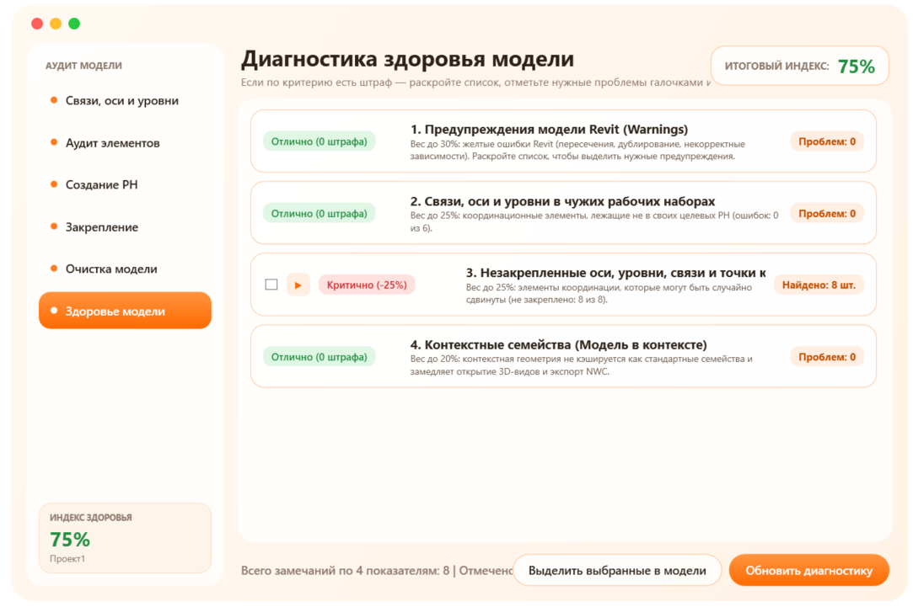

Comprehensive model check and cleanup in six sections:

| Section | What it does |
|---|---|
| Links, grids and levels | Checks that RVT links, grids and levels sit in their worksets (links are matched by the workset key `00_Связь_<key>`, both instance and link type) and fixes them automatically |
| Element audit | Table of all elements with 3D geometry (what ends up in NWC/IFC): category and workset filters, isolation in a 3D view, moving to a chosen workset |
| Workset creation | Creates worksets from CSV; exports a template and the project's workset list |
| Pinning | Controls pinning of grids, levels, links and base points |
| Model cleanup | Imported DWG, unplaced images and PDFs, sections not on sheets, unused families, groups and view filters |
| Model health | Health index 0–100 % with expandable issue lists and element selection in the model |

Unused families are detected with the same rule as Revit's built-in *Purge Unused*
(Performance Adviser), so tags, level/grid heads, profiles and families referenced by type
parameters are not reported. Sections whose dependent views are placed on sheets are never
offered for deletion.

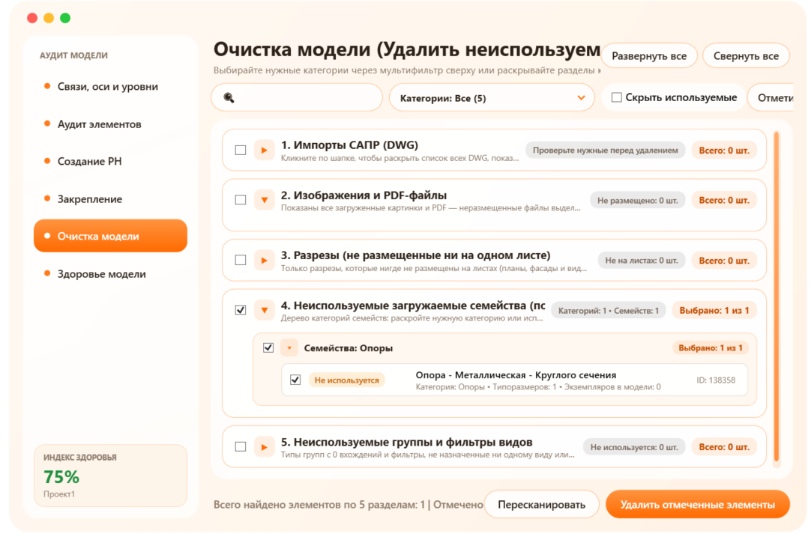

**Health index** = 100 % minus penalties:

| Criterion | Penalty |
|---|---|
| Revit warnings | 1 % per 15 warnings (at least 1 %), up to 30 % |
| Links, grids and levels in wrong worksets | share of errors × 25 %, from 2 to 25 % |
| Unpinned grids, levels, links, base points | share of unpinned × 25 %, from 1 to 25 % |
| In-place families | 2 % each, up to 20 % |

### Model Export

Batch export of models to **NWC**, **IFC** or both at once.

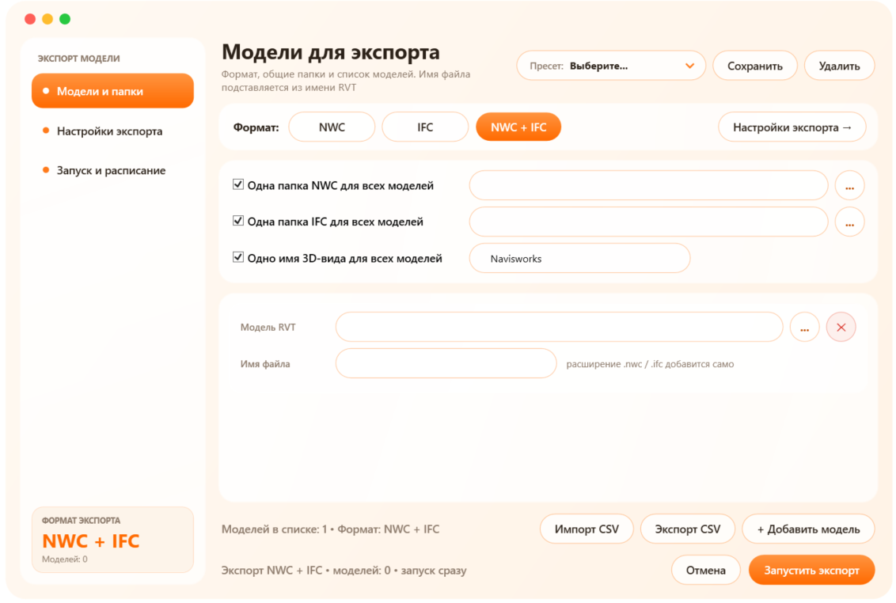

- Models are opened in the background; workshared models are detached from central, link worksets can be left closed.
- One output folder and 3D view name for all models, or individual ones; the file name defaults to the RVT name.
- The *Export settings* section mirrors Revit's NWC and IFC export dialogs; settings are saved to a file and to presets.
- If the 3D view is missing, a temporary one is created and removed after export — the model is not changed.
- Pre-flight checks: files and folders exist, Revit file version, duplicate file names in one folder.
- Scheduled (overnight) run, a log for every run, automatic dismissal of Revit dialogs during unattended export.

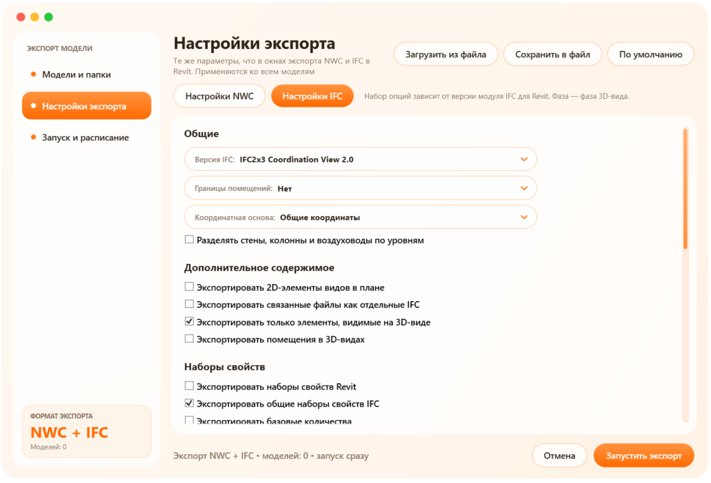

### Low-voltage schematics (Схемы СС)

Generates a structural schematic of a low-voltage system on a drafting view from model data:
building → floor (by elevation) → panel → loops → devices in connection order.

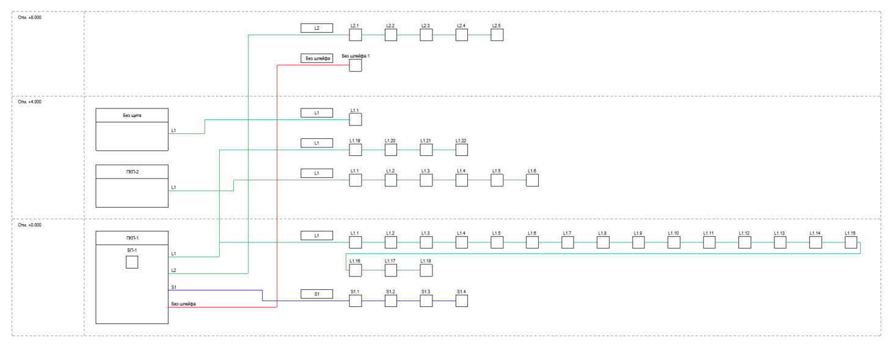

- Data comes from `CEC_*` parameters (system, panel, loop, symbol, mark, building).
- Device order — by distance from the panel or by marks; long loops wrap as a snake.
- Symbols are the project's generic annotations; loop lines are coloured by loop type.
- A report lists data issues: a loop declared in several panels, devices without a loop or level, missing symbols.
- *Project parameters* binds the `CEC_*` parameters to equipment categories from the shared parameter file in one click.
- *Demo schematic* builds a diagram from synthetic data — to check the layout without any elements in the model.

The layout engine is plain Python, decoupled from the Revit API, so it can be tested outside Revit.

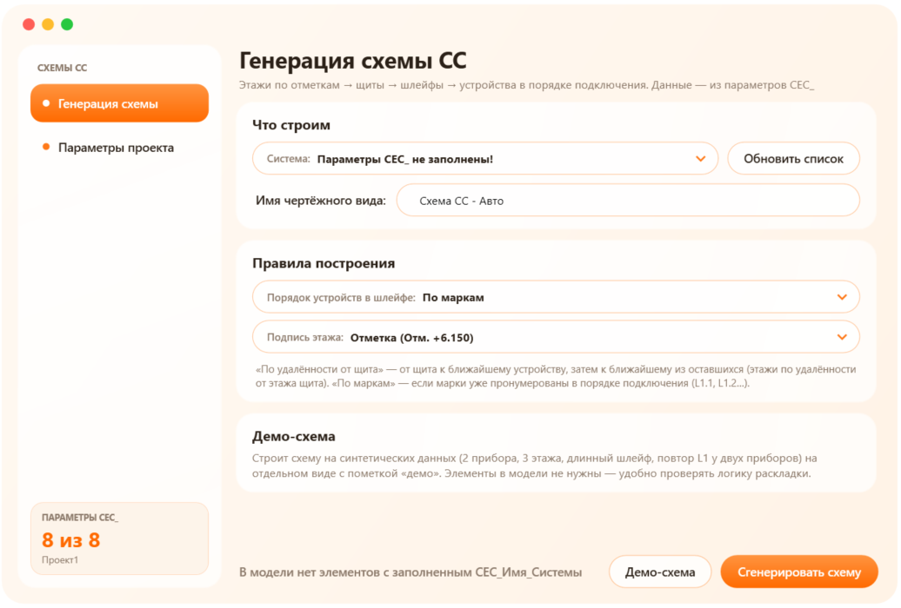

### KZh — reinforced concrete detailing

The **«Конструктив»** tab reinforces structural elements to the Russian code SP 63.13330; drawings in the windows
follow GOST / SPDS drafting standards. Elements are grouped by cross-section; a scheme is set up per group and turned
into Revit `Rebar` with covers, hooks, laps and anchorage.

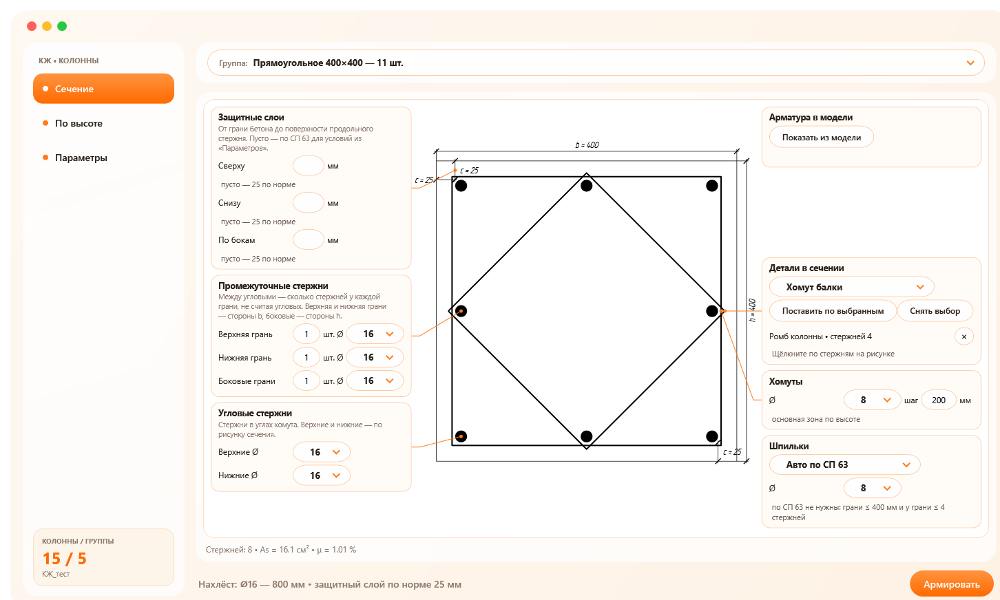

| Button | What it does |
|---|---|
| Project setup | Rebar shared parameters, code settings (covers, anchorage, laps), bar shapes |
| Columns | Rectangular and round sections, parts along the height and corbels, tie zones, starter bars |
| Beams | Bottom, top and side bars, stirrups and pins, zones along the span, flanges |
| Walls | One or two meshes, shear walls with boundary zones, U-bars at wall ends, opening trimmer bars |
| Slabs | Solid, foundation, on metal deck, ribbed; meshes and edge U-bars |
| Junctions | L and T wall junctions: L- and U-bars, vertical bars in the junction |
| Stairs | Cast-in-place stairs: flight meshes, L-bars in steps, edge U-bars, landings |
| Details | Configurator for stirrups, rhombs, pins, "frog" ties, L- and U-bars |
| Service | Rebar check, marks and steel take-off, re-reinforcing changed elements |

- Every window shows the element section or view as a GOST/SPDS drawing with dimensions, leaders and break lines; inputs sit next to what they change.
- An empty field means "per code": cover, spacing, anchorage and lap come from SP 63 for the chosen diameter and conditions.
- A list of elements is shown before rebar is created; existing rebar is replaced only after confirmation.
- *Show from model* in *Columns* and *Beams* draws the section from the rebar already placed in the element — to review finished reinforcement.

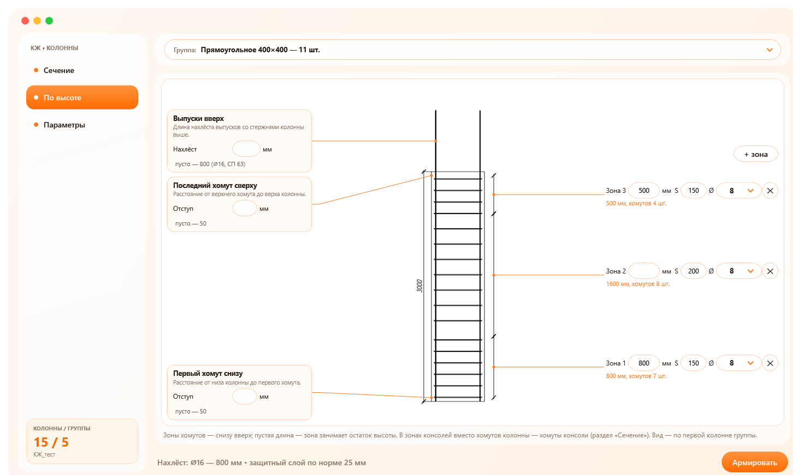

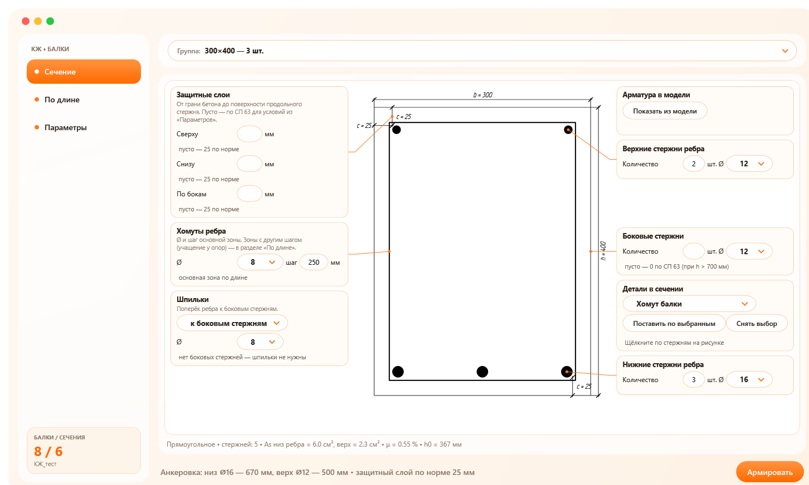

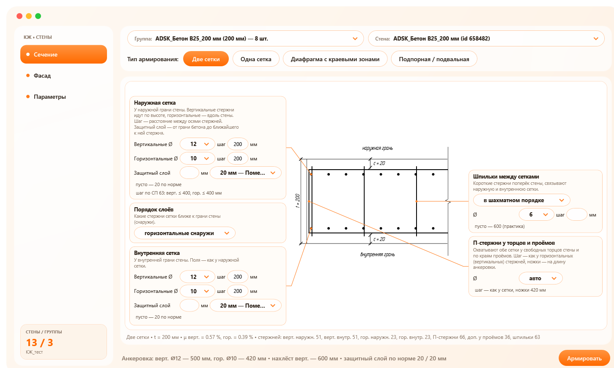

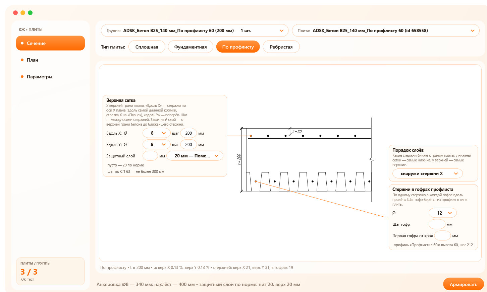

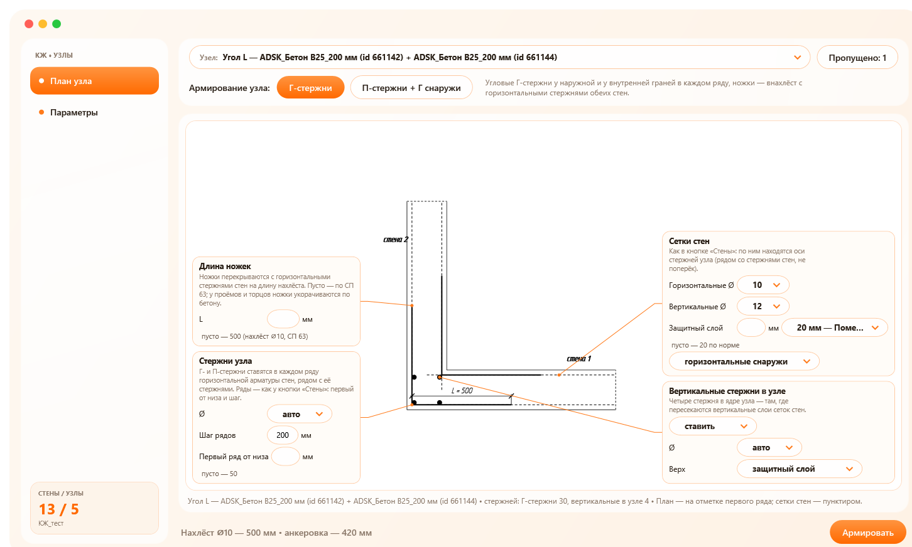

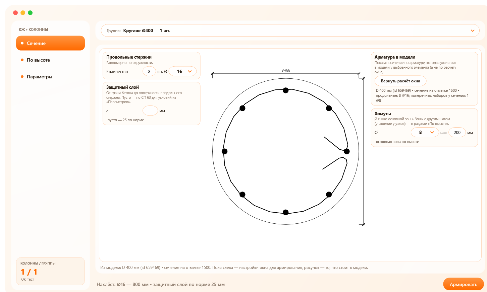

**Details.** Stirrups, rhombs, pins, "frog" ties, troughs, L- and U-bars are drawn like a row of a bar bending
schedule: dimensions are edited right on the sketch, length and mass update instantly. The library lives in the user
profile and is available in any project. In the *Columns* and *Beams* windows a detail is placed by clicking the bars
of the section: a stirrup or rhomb wraps the selected bars, a pin goes between two.

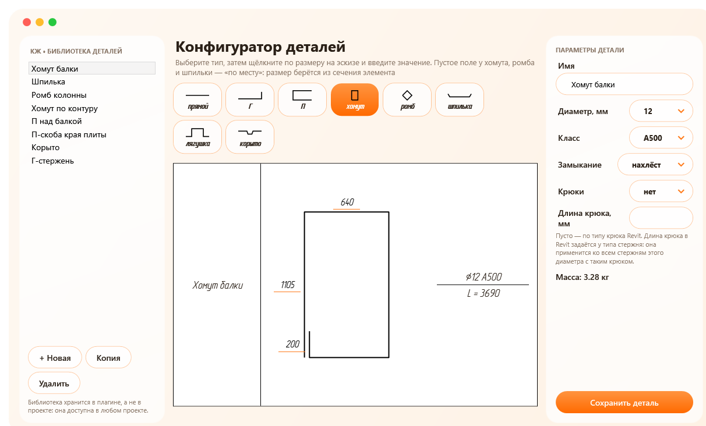

**Service.** The check finds bars outside concrete, cover below code and spacing above code. Identical bars share
one mark; the steel take-off exports to CSV. Each reinforced element remembers its geometry, so after a size change
the plugin shows what needs re-reinforcing.

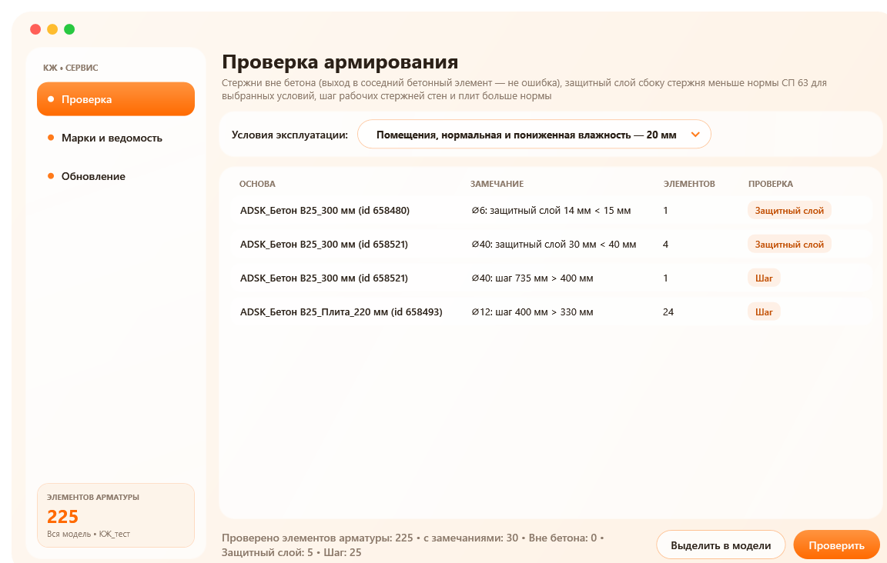

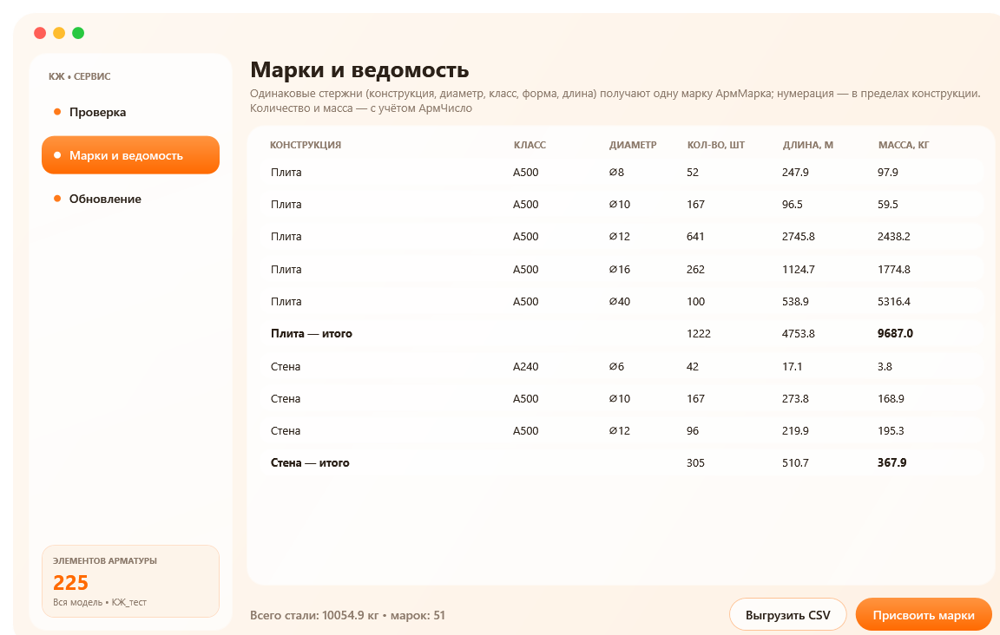

## Installation

1. Install [pyRevit](https://github.com/pyrevitlabs/pyRevit).
2. Download the repository (`git clone` or ZIP).
3. In Revit: **pyRevit → Settings → Custom Extension Directories** → add the path to the `PyRevit-Scripts-BIM` folder.
4. **Reload** — the **«Общее»** tab appears with the *Model check*, *Export* and *Electrical* panels,
   and the **«Конструктив»** tab with the *KZh* panel.

Requirements:

- Autodesk Revit 2022;
- NWC export needs the Navisworks NWC Export Utility, IFC export needs IFC for Revit;
- *Model Audit* works with workshared models (worksets enabled);
- for KZh, run *Project setup* once in the model (shared parameters and bar shapes).

## Structure

```
PyRevit-Scripts-BIM/
└── BIMTools.extension/
    ├── Общее.tab/
    │   ├── Проверка модели.panel/Аудит.pushbutton/        model audit and cleanup
    │   ├── Экспорт.panel/Экспорт модели.pushbutton/       batch NWC / IFC export
    │   └── Электрика.panel/Схемы СС.pushbutton/           low-voltage schematic generator
    ├── Конструктив.tab/КЖ.panel/                          rebar: columns, beams, walls, slabs, junctions,
    │                                                      stairs, details, service, project setup
    └── lib/kzh/                                           shared KZh code: code tables, section layout,
                                                           Rebar creation, SPDS drawings, section editor
```

Each button is a `*.pushbutton` folder with `script.py` and `icon.png`.

## Tech stack

- **IronPython** (pyRevit engine) and the **Revit API**: transactions, worksets, shared parameters, NWC/IFC export, Performance Adviser,
  rebar (`Rebar`, `RebarShape`, `RebarConstraintsManager`), Extensible Storage.
- **WPF / XAML**: custom window styles; modeless windows use `ExternalEvent` for safe model access.
- Presets and settings are stored as JSON in the user profile; project data never leaves the machine.

## Author

Daniil Antonenko — BIM coordinator, Revit automation developer ·
[Telegram @spirtazaru](https://t.me/spirtazaru) · antonencodaniil@gmail.com
