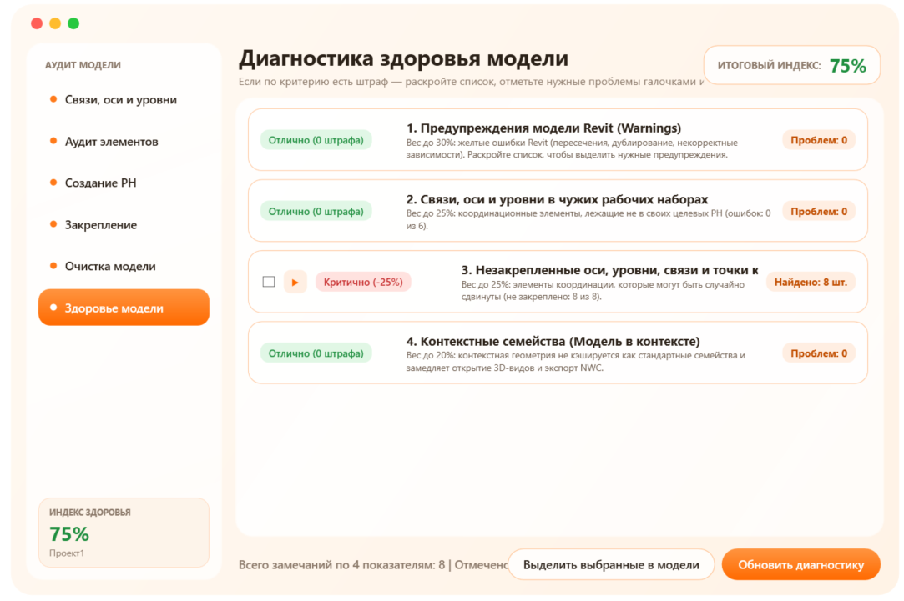
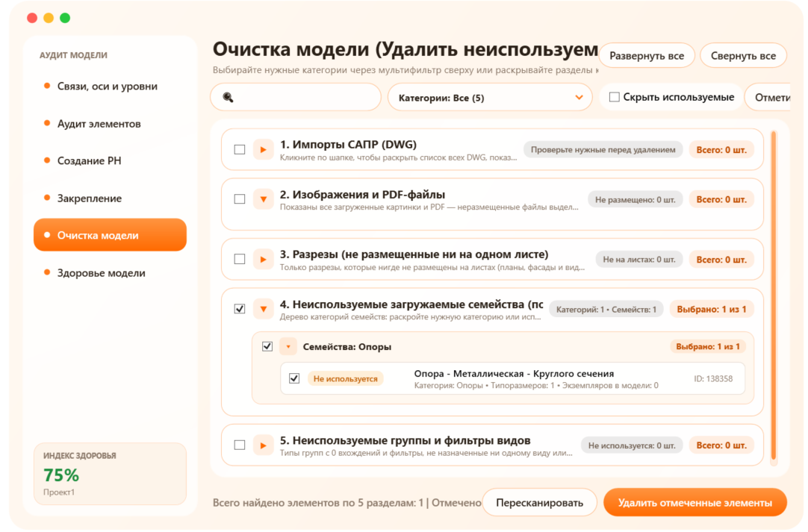
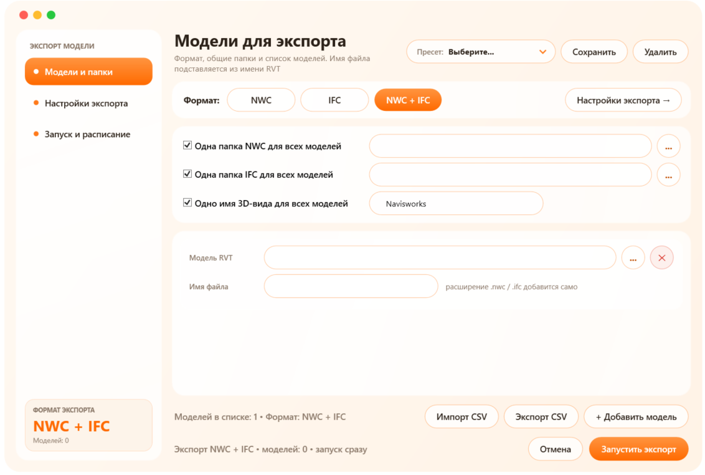
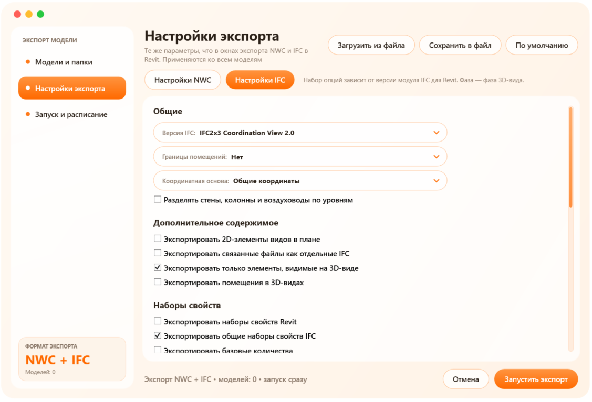
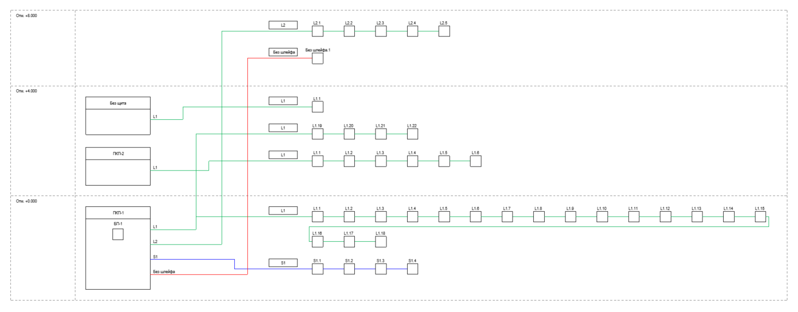
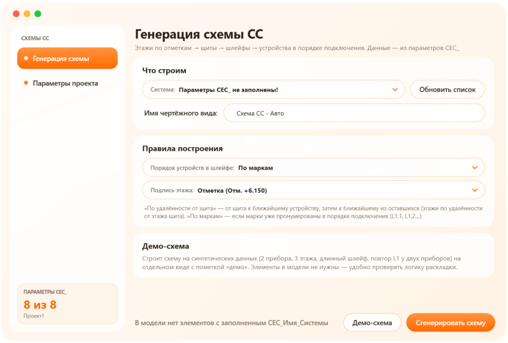

# BIMTools — pyRevit plugins for Autodesk Revit

**English** · [Русский](README.ru.md)

A set of BIM coordination and design automation tools: model audit and cleanup,
batch export to NWC and IFC, and generation of low-voltage system schematics from model data.

All plugins run inside Revit, share one consistent UI (orange palette, sidebar navigation)
and never change the model without confirmation: every modification or deletion is preceded
by a list of the affected elements.

> The plugin UI is in Russian — the tools were built for Russian design offices
> (Russian workset naming standards and drawing conventions).

## Plugins

### Model Audit



Comprehensive model check and cleanup in six sections:

| Section | What it does |
|---|---|
| Links, grids and levels | Checks that RVT links, grids and levels sit in their worksets (links are matched by the workset key `00_Связь_<key>`, both instance and link type) and fixes them automatically |
| Element audit | Table of all elements with 3D geometry (what ends up in NWC/IFC): category and workset filters, isolation in a 3D view, moving to a chosen workset |
| Workset creation | Creates worksets from CSV; exports a template and the project's workset list |
| Pinning | Controls pinning of grids, levels, links and base points |
| Model cleanup | Imported DWG, unplaced images and PDFs, sections not on sheets, unused families, groups and view filters |
| Model health | Health index 0–100 % with expandable issue lists and element selection in the model |

Unused families are detected with the same rule as Revit's built-in *Purge Unused*
(Performance Adviser), so tags, level/grid heads, profiles and families referenced by type
parameters are not reported. Sections whose dependent views are placed on sheets are never
offered for deletion.



**Health index** = 100 % minus penalties:

| Criterion | Penalty |
|---|---|
| Revit warnings | 1 % per 15 warnings (at least 1 %), up to 30 % |
| Links, grids and levels in wrong worksets | share of errors × 25 %, from 2 to 25 % |
| Unpinned grids, levels, links, base points | share of unpinned × 25 %, from 1 to 25 % |
| In-place families | 2 % each, up to 20 % |

### Model Export

Batch export of models to **NWC**, **IFC** or both at once.



- Models are opened in the background; workshared models are detached from central, link worksets can be left closed.
- One output folder and 3D view name for all models, or individual ones; the file name defaults to the RVT name.
- The *Export settings* section mirrors Revit's NWC and IFC export dialogs; settings are saved to a file and to presets.
- If the 3D view is missing, a temporary one is created and removed after export — the model is not changed.
- Pre-flight checks: files and folders exist, Revit file version, duplicate file names in one folder.
- Scheduled (overnight) run, a log for every run, automatic dismissal of Revit dialogs during unattended export.



### Low-voltage schematics (Схемы СС)

Generates a structural schematic of a low-voltage system on a drafting view from model data:
building → floor (by elevation) → panel → loops → devices in connection order.



- Data comes from `CEC_*` parameters (system, panel, loop, symbol, mark, building).
- Device order — by distance from the panel or by marks; long loops wrap as a snake.
- Symbols are the project's generic annotations; loop lines are coloured by loop type.
- A report lists data issues: a loop declared in several panels, devices without a loop or level, missing symbols.
- *Project parameters* binds the `CEC_*` parameters to equipment categories from the shared parameter file in one click.
- *Demo schematic* builds a diagram from synthetic data — to check the layout without any elements in the model.

The layout engine is plain Python, decoupled from the Revit API, so it can be tested outside Revit.



## Installation

1. Install [pyRevit](https://github.com/pyrevitlabs/pyRevit).
2. Download the repository (`git clone` or ZIP).
3. In Revit: **pyRevit → Settings → Custom Extension Directories** → add the path to the `PyRevit-Scripts-BIM` folder.
4. **Reload** — the **«Общее»** tab appears with the *Model check*, *Export* and *Electrical* panels.

Requirements:

- Autodesk Revit 2022;
- NWC export needs the Navisworks NWC Export Utility, IFC export needs IFC for Revit;
- *Model Audit* works with workshared models (worksets enabled).

## Structure

```
PyRevit-Scripts-BIM/
└── BIMTools.extension/
    └── Общее.tab/
        ├── Проверка модели.panel/Аудит.pushbutton/        model audit and cleanup
        ├── Экспорт.panel/Экспорт модели.pushbutton/       batch NWC / IFC export
        └── Электрика.panel/Схемы СС.pushbutton/           low-voltage schematic generator
```

Each button is a `*.pushbutton` folder with `script.py` and `icon.png`.

## Tech stack

- **IronPython** (pyRevit engine) and the **Revit API**: transactions, worksets, shared parameters, NWC/IFC export, Performance Adviser.
- **WPF / XAML**: custom window styles; modeless windows use `ExternalEvent` for safe model access.
- Presets and settings are stored as JSON in the user profile; project data never leaves the machine.

## Author

Daniil Antonenko — BIM coordinator, Revit automation developer ·
[Telegram @spirtazaru](https://t.me/spirtazaru) · antonencodaniil@gmail.com
