# BIMTools — плагины для Autodesk Revit (pyRevit)

[English](README.md) · **Русский**

Набор инструментов автоматизации BIM-координации и проектирования: аудит и очистка модели,
пакетный экспорт в NWC и IFC, генерация структурных схем слаботочных систем,
армирование железобетонных конструкций (КЖ).

Все плагины работают внутри Revit, имеют единый интерфейс (оранжевая палитра, левое меню по разделам)
и не меняют модель без подтверждения: перед каждым изменением или удалением показывается список
затрагиваемых элементов.

## Плагины

### Аудит модели

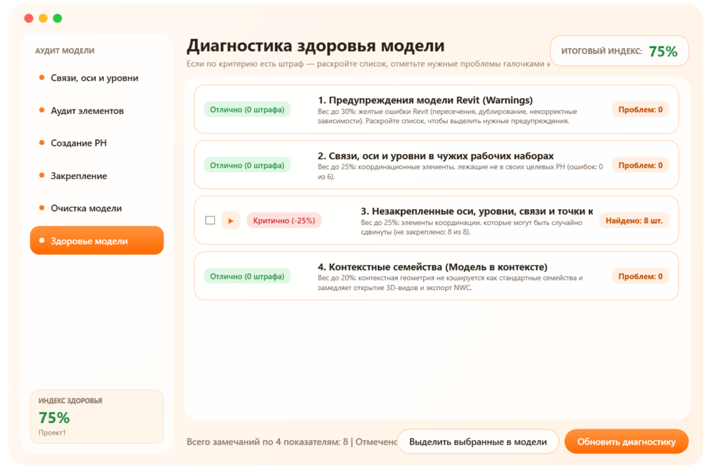

Комплексная проверка и очистка модели. Шесть разделов:

| Раздел | Что делает |
|---|---|
| Связи, оси и уровни | Проверяет, что связи RVT, оси и уровни лежат в своих рабочих наборах (связи — по ключу в имени РН `00_Связь_<ключ>`), и переносит их автоматически |
| Аудит элементов | Таблица всех элементов с 3D-геометрией (то, что попадает в NWC/IFC): фильтры по категориям и РН, изоляция на 3D-виде, перенос в выбранный РН |
| Создание РН | Создание рабочих наборов из CSV, выгрузка шаблона и списка РН проекта |
| Закрепление | Контроль закрепления осей, уровней, связей и базовых точек |
| Очистка модели | Импорты DWG, неразмещённые изображения и PDF, разрезы не на листах, неиспользуемые семейства, группы и фильтры видов |
| Здоровье модели | Индекс здоровья 0–100 % с раскрывающимися списками проблем и выделением элементов в модели |

Неиспользуемые семейства определяются тем же правилом, что и штатная команда «Удалить неиспользуемое»
(Performance Adviser), поэтому марки, головки уровней и осей, профили и семейства из параметров типов
в список не попадают. Разрезы, у которых зависимые виды стоят на листах, тоже не предлагаются к удалению.

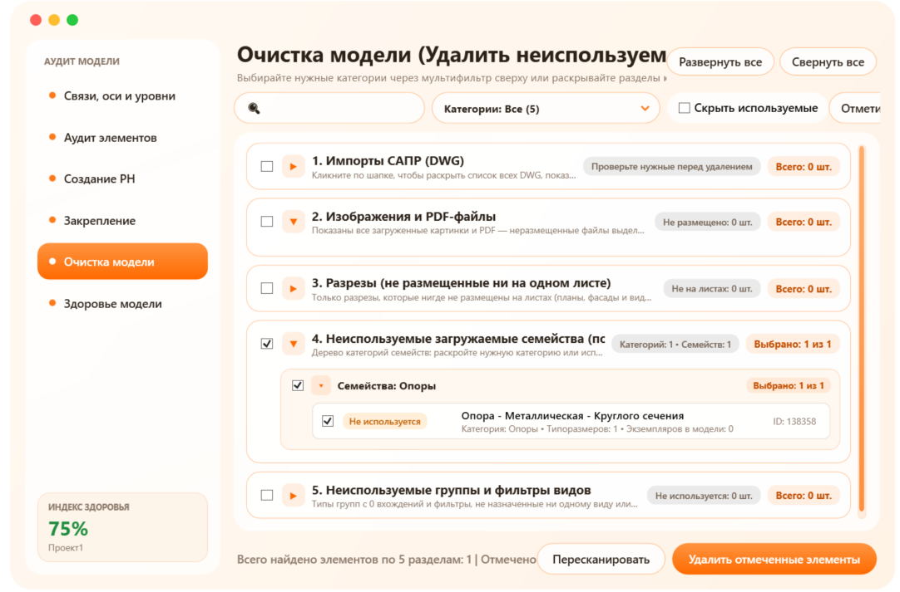

**Индекс здоровья** = 100 % минус сумма штрафов:

| Показатель | Штраф |
|---|---|
| Предупреждения Revit | 1 % за каждые 15 предупреждений (не меньше 1 %), не более 30 % |
| Связи, оси и уровни в чужих РН | доля ошибочных × 25 %, от 2 до 25 % |
| Незакреплённые оси, уровни, связи, базовые точки | доля незакреплённых × 25 %, от 1 до 25 % |
| Контекстные семейства | 2 % за каждое, не более 20 % |

### Экспорт модели

Пакетный экспорт моделей в **NWC**, **IFC** или в оба формата сразу.

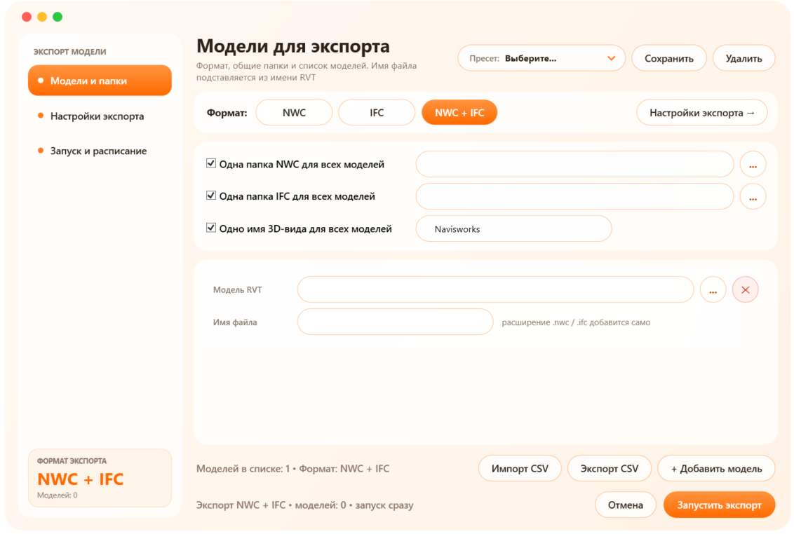

- Модели открываются в фоне; совместные — с отсоединением от центральной, рабочие наборы связей можно не загружать.
- Общая папка и общее имя 3D-вида для всех моделей или свои для каждой; имя файла по умолчанию — имя RVT.
- Раздел «Настройки экспорта» повторяет параметры окон экспорта NWC и IFC в Revit; настройки сохраняются в файл и в пресеты.
- Если 3D-вида нет, создаётся временный и удаляется после экспорта — модель не меняется.
- Проверки до запуска: существование файлов и папок, версия файла Revit, совпадение имён файлов в одной папке.
- Отложенный запуск в заданное время, журнал каждого запуска, автоматическое закрытие диалогов Revit при ночном экспорте.

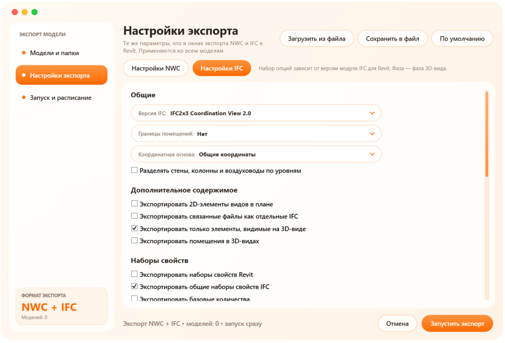

### Схемы СС

Генерация структурной схемы слаботочной системы на чертёжном виде по данным модели:
корпус → этаж (по отметке) → щит → шлейфы → устройства в порядке подключения.

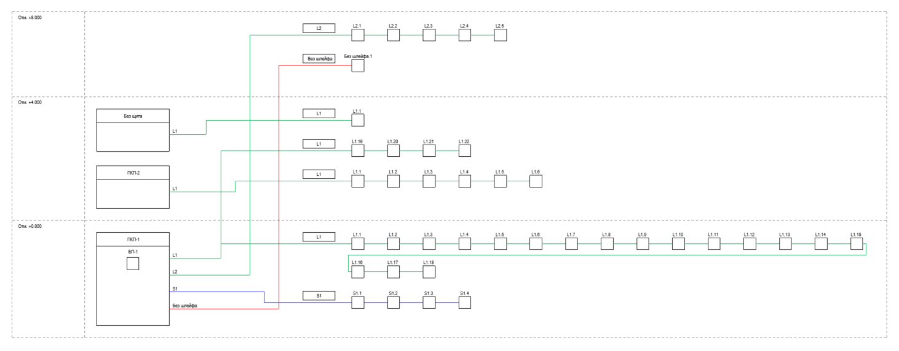

- Данные — из параметров `CEC_*` (система, щит, шлейф, УГО, марка, корпус).
- Порядок устройств — по удалённости от щита или по маркам; длинные шлейфы переносятся «змейкой».
- УГО — типовые аннотации проекта; линии шлейфов окрашиваются по типу шлейфа.
- Отчёт с замечаниями к данным: шлейф в нескольких щитах, устройства без шлейфа или уровня, отсутствующие УГО.
- Раздел «Параметры проекта» одной кнопкой привязывает `CEC_*` к категориям оборудования из файла общих параметров.
- «Демо-схема» строит схему на синтетических данных — для проверки раскладки без элементов в модели.

Раскладка схемы написана на чистом Python и отделена от Revit API, поэтому её можно проверять вне Revit.

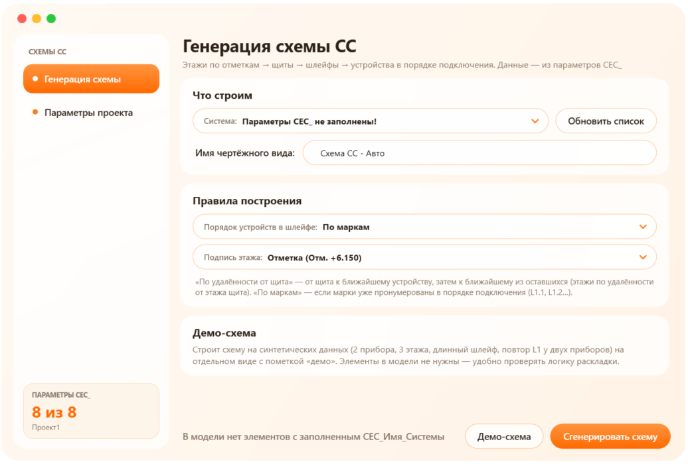

### КЖ — армирование железобетона

Вкладка **«Конструктив»**: армирование несущих элементов по СП 63.13330, чертежи в окнах — по ГОСТ/СПДС.
Элементы группируются по сечению; для группы настраивается схема, и по ней создаётся арматура Revit
(`Rebar`) с защитными слоями, крюками, нахлёстами и анкеровкой.

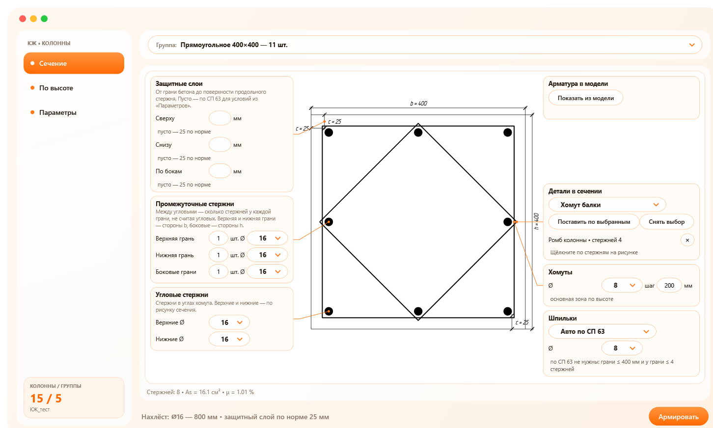

| Кнопка | Что делает |
|---|---|
| Подготовка проекта | Общие параметры арматуры, нормы (защитные слои, анкеровка, нахлёсты), формы стержней |
| Колонны | Прямоугольные и круглые сечения, участки по высоте и консоли, зоны учащения хомутов, выпуски |
| Балки | Нижние, верхние и боковые стержни, хомуты и шпильки, зоны по длине пролёта, полки |
| Стены | Одна или две сетки, диафрагмы с краевыми зонами, П-стержни у торцов, усиление проёмов |
| Плиты | Сплошные, фундаментные, по профлисту, ребристые; сетки и П-скобы по краю |
| Узлы | Сопряжения стен L и T: Г- и П-стержни, вертикальные стержни в узле |
| Лестницы | Монолитные лестницы: сетки маршей, Г-стержни ступеней, П-стержни по краям, площадки |
| Детали | Конфигуратор хомутов, ромбов, шпилек, лягушек, Г- и П-стержней |
| Сервис | Проверка армирования, марки и ведомость расхода стали, повторное армирование изменённых элементов |

- Окна показывают сечение или вид элемента как чертёж по ГОСТ/СПДС: размеры, выноски, линии обрыва; поля ввода стоят рядом с тем, что они меняют.
- Пустое поле означает «по норме»: защитный слой, шаг, анкеровка и нахлёст подставляются по СП 63 для выбранного диаметра и условий.
- Перед созданием арматуры показывается список элементов; уже заармированные элементы перезаписываются только после подтверждения.
- «Показать из модели» в «Колоннах» и «Балках» рисует сечение по арматуре, которая уже стоит у элемента, — для проверки готового армирования.

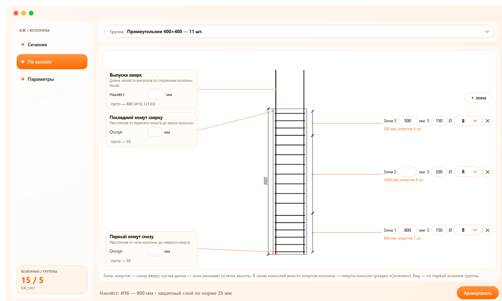

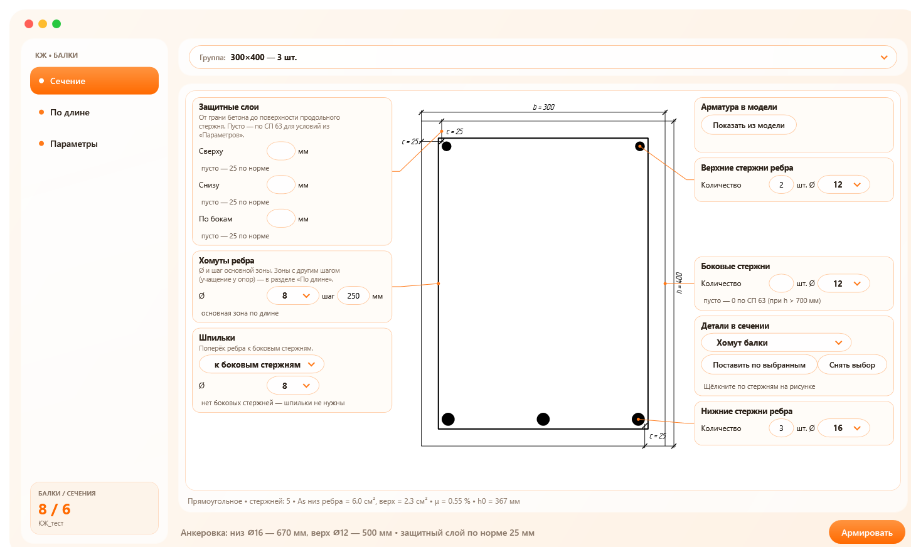

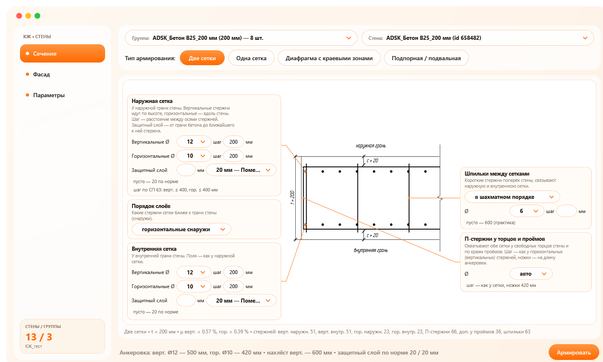

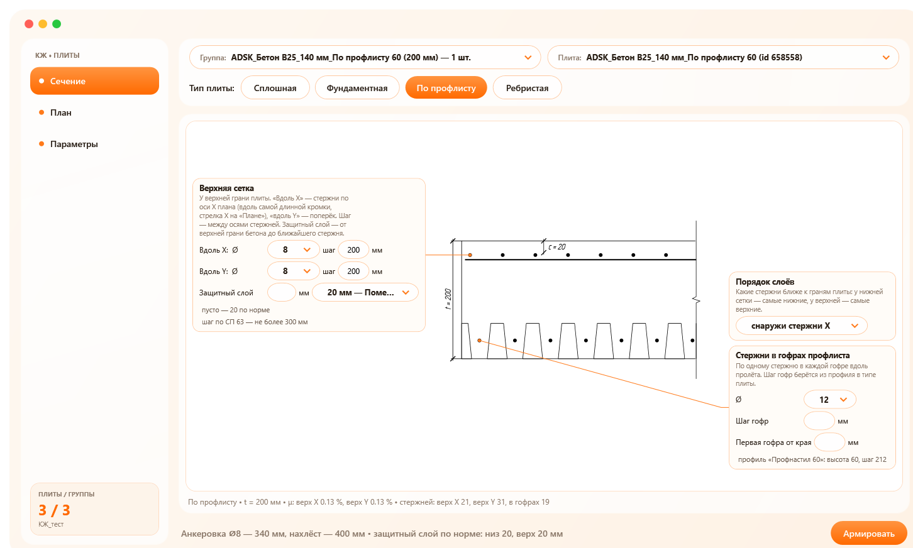

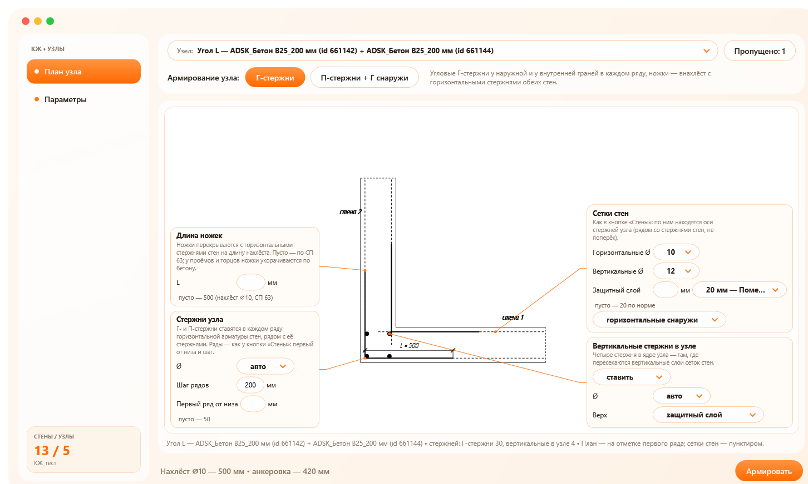

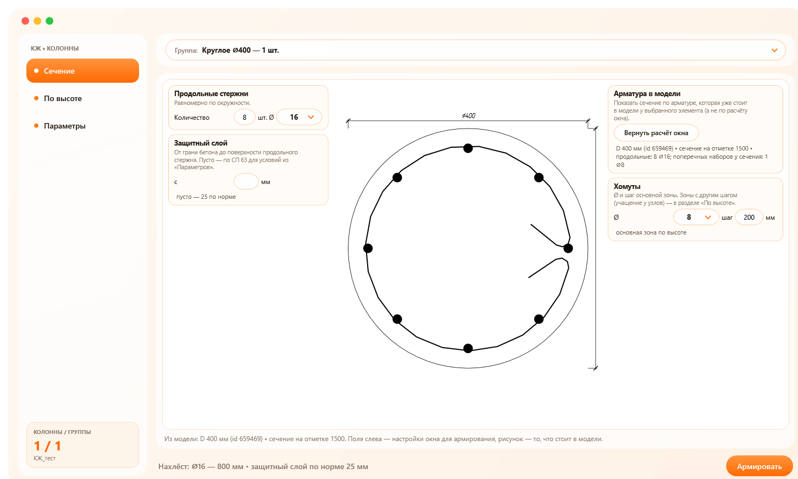

**Детали.** Хомут, ромб, шпилька, лягушка, корыто, Г- и П-стержни рисуются как графа ведомости деталей:
размеры правятся прямо на эскизе, длина и масса считаются сразу. Библиотека хранится в профиле пользователя и
доступна в любом проекте. В окнах «Колонны» и «Балки» деталь ставится щелчком по стержням сечения: хомут и ромб
охватывают выбранные стержни, шпилька ставится между двумя.

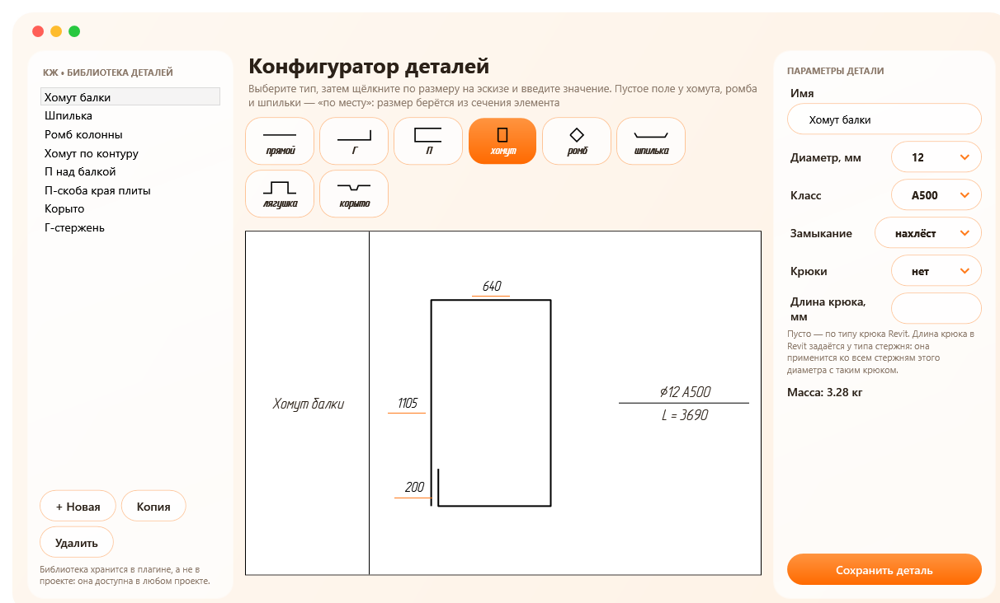

**Сервис.** Проверка находит стержни вне бетона, защитный слой меньше нормы и шаг больше нормы.
Одинаковые стержни получают одну марку; ведомость расхода стали выгружается в CSV. Каждый заармированный
элемент запоминает свою геометрию, поэтому после изменения размеров плагин покажет, что нужно переармировать.

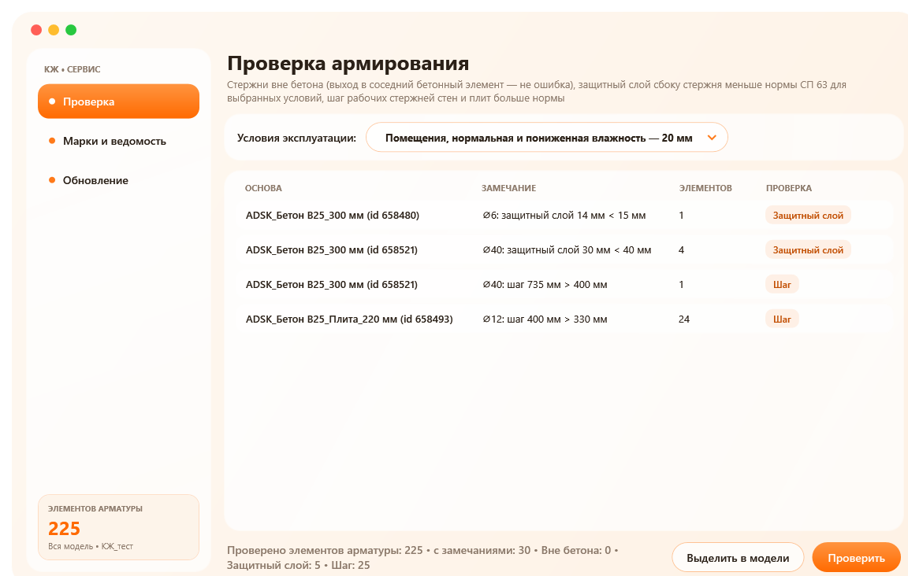

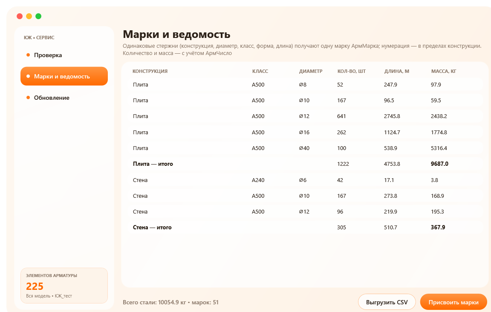

## Установка

1. Установите [pyRevit](https://github.com/pyrevitlabs/pyRevit).
2. Скачайте репозиторий (`git clone` или ZIP).
3. В Revit: **pyRevit → Settings → Custom Extension Directories** → добавьте путь к папке `PyRevit-Scripts-BIM`.
4. **Reload** — появятся вкладка **«Общее»** с панелями «Проверка модели», «Экспорт» и «Электрика»
   и вкладка **«Конструктив»** с панелью «КЖ».

Требования:

- Autodesk Revit 2022;
- для экспорта NWC — Navisworks NWC Export Utility, для IFC — модуль IFC для Revit;
- плагин «Аудит модели» работает с совместными моделями (с рабочими наборами);
- для КЖ — один раз запустить «Подготовка проекта» в модели (общие параметры и формы стержней).

## Структура

```
PyRevit-Scripts-BIM/
└── BIMTools.extension/
    ├── Общее.tab/
    │   ├── Проверка модели.panel/Аудит.pushbutton/        аудит и очистка модели
    │   ├── Экспорт.panel/Экспорт модели.pushbutton/       пакетный экспорт NWC / IFC
    │   └── Электрика.panel/Схемы СС.pushbutton/           генератор схем слаботочных систем
    ├── Конструктив.tab/КЖ.panel/                          армирование: колонны, балки, стены, плиты, узлы,
    │                                                      лестницы, детали, сервис, подготовка проекта
    └── lib/kzh/                                           общий код КЖ: нормы, расчёт сечений, создание Rebar,
                                                           чертежи СПДС, редактор сечения
```

Каждая кнопка — папка `*.pushbutton` со `script.py` и `icon.png`.

## Технологии

- **IronPython 2.7** (движок pyRevit) и **Revit API 2022**: транзакции, рабочие наборы, общие параметры, экспорт NWC/IFC, Performance Adviser,
  армирование (`Rebar`, `RebarShape`, `RebarConstraintsManager`), Extensible Storage.
- **WPF / XAML**: собственные стили окон, немодальные окна с `ExternalEvent` для безопасной работы с моделью.
- Пресеты и настройки — JSON в профиле пользователя; проектные данные никуда не передаются.

## Автор

Даниил Антоненко
